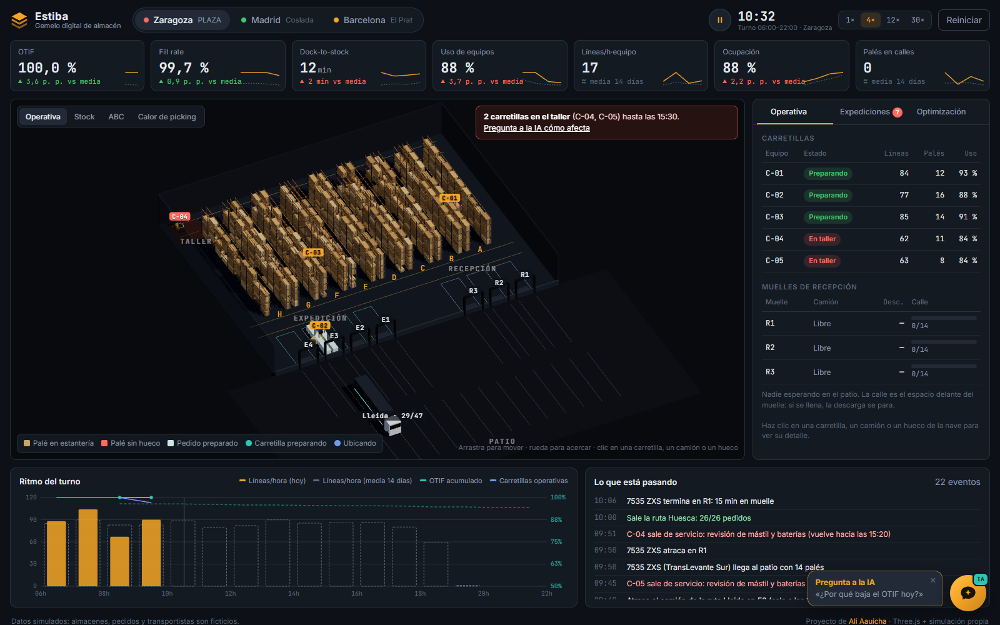
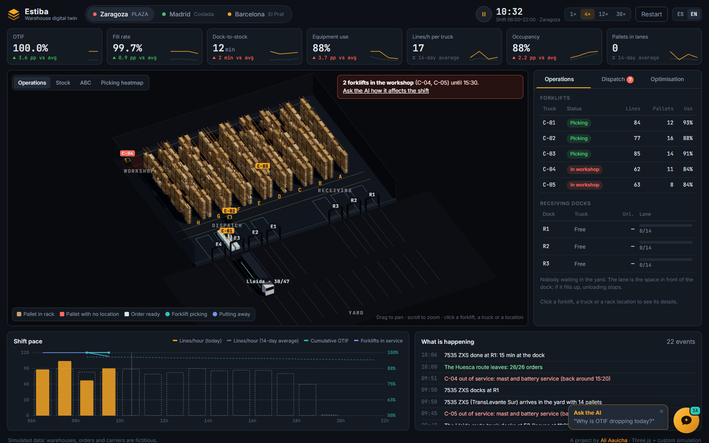

# Estiba · gemelo digital de operaciones logísticas

*Español · [English](#english)*

La interfaz y el asistente funcionan en español e inglés (botón ES/EN, o `?lang=en` en la URL).

Tres operativas logísticas simuladas en 3D, cada una con su motor de simulación, sus indicadores, su
seguimiento paso a paso y un asistente que explica las desviaciones con los datos del propio turno.

**Demo en vivo: https://d1ex3zlctjya5a.cloudfront.net**

[](https://d1ex3zlctjya5a.cloudfront.net/?lang=es)

No es una maqueta: cada carretilla, camión, coche y paquete que se ve sale de un motor de simulación por
eventos, y los indicadores se calculan sobre lo que ocurre en él.

## Las tres operativas

Se eligen arriba (`?op=almacen`, `?op=automocion` o `?op=milla` en la URL). Cada una esconde un problema hoy
para que el análisis tenga algo que encontrar.

### Almacén (Zaragoza)
- **Cadena completa:** camión → patio → muelle → calle de recepción → la carretilla ubica el palé → stock disponible
  → liberación por olas → picking → la ruta sale a su hora. Un fallo en un eslabón se ve en los siguientes.
- **Indicadores:** OTIF, fill rate de líneas, dock-to-stock, utilización y productividad de equipos, ocupación y palés en calles.
- **Vistas de la nave:** operativa, nivel de stock por hueco, clasificación ABC y calor de picking.
- **Optimización:** «como está», «ruta optimizada» y «slotting ABC + ruta» sobre los pedidos del día, con re-simulación.
- **Hoy:** dos de cinco carretillas pasan por el taller entre las 09:45 y las 15:30.

### Automoción (proveedores Tier 1-3 → fabricante)
- **La pirámide en una escena:** cinco Tier 3 (materias primas), cuatro Tier 2 (componentes) y cuatro Tier 1 que fabrican
  módulos **en secuencia** (cockpit, puertas, asientos y frontal) y los mandan en lanzaderas JIT a la línea de montaje;
  al final, banco de pruebas, retrabajo, campa y portavehículos.
- **Aprovisionamiento por tirón:** cada cliente pide a su proveedor cuando su stock más lo que viene de camino baja del
  punto de pedido. Si a una estación le falta el módulo del coche que entra, se para toda la línea.
- **Indicadores:** cumplimiento del plan, coches montados, minutos de paro, cobertura JIS a pie de línea, lanzaderas a
  tiempo, FPY e insumos en riesgo.
- **Plan B:** re-simula el día con un proveedor alternativo de chips desde las 10:00.
- **Hoy:** el fabricante de semiconductores recorta la cuota al 25 %; tarda horas en notarse, pero acaba parando la
  línea por falta de frontales y cockpits sin centralitas. Además, la lanzadera de asientos se retrasa por un accidente.

### Última milla (cross-dock → delegaciones → cliente final)
- **Cross-dock:** camiones de los clientes (moda, deporte, comida a domicilio refrigerada y e-commerce) → muelles de
  entrada → cola de inducción → sorter → rampa de cada delegación → camiones en tres olas (09:00, 12:00 y 15:00).
- **Delegaciones de provincia** en un esquema por rumbo y distancia, con sus furgonetas repartiendo y los puntos de
  entrega que se marcan como entregados o ausentes.
- **Indicadores:** bultos clasificados, cola del sorter, bultos que salen en su ola, tiempo en el cross-dock,
  entregas, entrega a la primera y conductores en ruta.
- **Plan B:** inducción manual durante el atasco y conductores de refuerzo en la delegación con bajas.
- **Hoy:** el sorter se atasca una hora antes de la primera ola, un camión de Zara llega 75 min tarde y Toledo tiene tres
  conductores de baja.

## Común a las tres
- **En vivo:** el reloj es la hora real de España y la simulación avanza minuto a minuto. El turno es de 06:00 a 22:00;
  de noche se reproduce el turno de día en diferido (con el aviso «EN DIFERIDO»).
- **Indicadores frente a la media de los 14 días anteriores a la misma hora** (mismo motor, otras semillas).
- **Seguimiento paso a paso** al pie de la escena: el pedido o el camión en el almacén, el coche (pedido → módulos Tier 1
  → montaje → calidad → expedición) o el paquete (recibido → clasificado → camión de ola → delegación → reparto →
  entregado), con botón para ir a él en la escena.
- **Avisos emergentes** con «Ver» (vuela la cámara hasta lo que pasa) y «Pregunta a la IA».
- **Cámara:** encuadres por zona, seguimiento de lo que se mueve y etiquetas con barra de progreso.
- **Asistente** en burbuja flotante: responde a «¿por qué baja el OTIF?», «¿por qué se para la línea?» o «¿por qué hay
  bultos que pierden su ola?» recorriendo la cadena de causas. El diagnóstico se calcula en el navegador y Claude (Amazon
  Bedrock) redacta la respuesta a partir de él (`lambda/asistente`), con dos controles en el servidor: las cifras se
  comprueban contra los datos y las acciones salen de una lista cerrada. Las preguntas sobre quién ha hecho Estiba o sobre
  su autor las contesta con su ficha profesional, con datos verificados y su LinkedIn (`lambda/asistente/ruta.mjs` decide
  a qué parte va cada pregunta; lo dudoso lo resuelve el modelo).

## Cómo está hecho

| Pieza | Fichero |
| --- | --- |
| Escena compartida (renderizador, cámara, encuadres, anillo de selección) | `src/scene/stage.js` |
| Operativas (lo propio de cada una: indicadores, pestañas, avisos, seguimiento) | `src/ops/*.js` |
| Almacén: geometría, motor, slotting, diagnóstico, escena | `src/sim/layout.js`, `src/sim/engine.js`, `src/analysis/optimize.js`, `src/analysis/assistant.js`, `src/scene/warehouse3d.js` |
| Automoción: red de proveedores, motor, diagnóstico, escena | `src/data/automocion.js`, `src/sim/automocion.js`, `src/analysis/asistenteAuto.js`, `src/scene/automocion3d.js` |
| Última milla: clientes y delegaciones, motor, diagnóstico, escena | `src/data/ultimamilla.js`, `src/sim/ultimamilla.js`, `src/analysis/asistenteMilla.js`, `src/scene/ultimamilla3d.js` |
| Histórico de 14 días y línea base por hora | `src/analysis/history.js` |
| Interfaz | `src/main.js`, `src/ui/*` |

Sin frameworks: Vite + Three.js + JavaScript. En producción: S3 + CloudFront (con OAC) para la web y una Lambda
con Function URL para el asistente (`deploy.ps1`).

## Uso

```bash
npm install
npm run dev        # http://localhost:5190
npm test           # pruebas de los tres motores, el slotting y el asistente
npm run build      # genera dist/
node scripts/probar-dia.mjs 5     # almacén: indicadores de 5 días, para calibrar
node scripts/probar-auto.mjs 5    # automoción (añade «dual» para el plan B)
node scripts/probar-milla.mjs 5   # última milla (añade «refuerzo» para el plan B)
```

Esc quita la selección.

## Asistente con Bedrock (opcional)

1. Crear una Lambda (Node.js 22) con los `.mjs` de `lambda/asistente` (`index.mjs` es el manejador; `deploy.ps1 -Lambda`
   los empaqueta), permiso `bedrock:InvokeModel` sobre el modelo y una Function URL con CORS limitado al dominio de la
   web. Variables opcionales: `TOPE_DIARIO` (preguntas del turno) y `TOPE_ALI` (preguntas sobre el autor).
   `ficha-ali.mjs` es la ficha del autor que comparten sus otros chats y se copia desde fuera del repositorio.
2. Compilar la web con la URL: `VITE_ESTIBA_API=https://…lambda-url…/ npm run build`.

Sin esa variable, el asistente responde solo con el motor local.

## Aviso

Todos los datos son simulados: pedidos, proveedores, volúmenes e incidencias son ficticios. Las marcas de la última
milla (Zara, Inditex, Decathlon, Gousto) se citan solo como ejemplo del tipo de cliente; no hay relación con ellas.

Autor: [Ali Aauicha](https://www.linkedin.com/in/ali-aauicha/)

---

## English

**Estiba** is a 3D digital twin of three logistics operations, each with its own event-driven simulation, KPIs,
step-by-step tracking and an assistant that explains deviations from the shift data.

**Live demo: https://d1ex3zlctjya5a.cloudfront.net/?lang=en**

[](https://d1ex3zlctjya5a.cloudfront.net/?lang=en)

- **Warehouse (Zaragoza):** yard → dock → receiving lane → put-away → stock → wave release → picking → route departure;
  OTIF, line fill rate, dock-to-stock, equipment utilisation, occupancy, ABC slotting with a full re-simulation.
  Today two of five forklifts are in the workshop.
- **Automotive supply chain:** Tier 3 raw materials → Tier 2 components → Tier 1 modules built **in sequence** and sent in
  JIT shuttles to the assembly line → test bench, rework, car park and transporters, all in one scene, with pull
  replenishment. KPIs: plan attainment, cars built, line stops, JIS coverage, shuttles on time, FPY, inputs at risk.
  Today the chip maker cuts the allocation to 25%: it takes hours to show, but it ends up stopping the line. Plan B
  re-simulates the day with an alternative chip supplier.
- **Last mile:** customer trucks (fashion, sport, chilled meal kits, e-commerce) → cross-dock → sorter → depot ramps →
  three departure waves → provincial depots → vans → end customer. Today the sorter jams before the first wave, a
  customer truck arrives 75 min late and one depot has three drivers off sick. Plan B adds a manual induction and
  standby drivers.
- **Shared:** live Spain time (replay at night), every KPI against the previous 14 days at the same time of day,
  step-by-step tracking of an order, car or parcel, actionable pop-up alerts ("View" flies the camera there), camera
  presets and follow mode, and an **AI assistant** (Claude on Amazon Bedrock) that walks the chain of causes, with figures
  checked server-side and actions from a closed list. Questions about who built Estiba are answered from the author's
  professional profile with verified facts and his LinkedIn.

Built with Vite + Three.js + plain JavaScript; deployed on S3 + CloudFront (OAC) with a Lambda Function URL for the
assistant. `npm install`, `npm run dev`, `npm test`. All data is simulated; last-mile brands are named only as example
customers, with no relationship to them.

Author: [Ali Aauicha](https://www.linkedin.com/in/ali-aauicha/)
