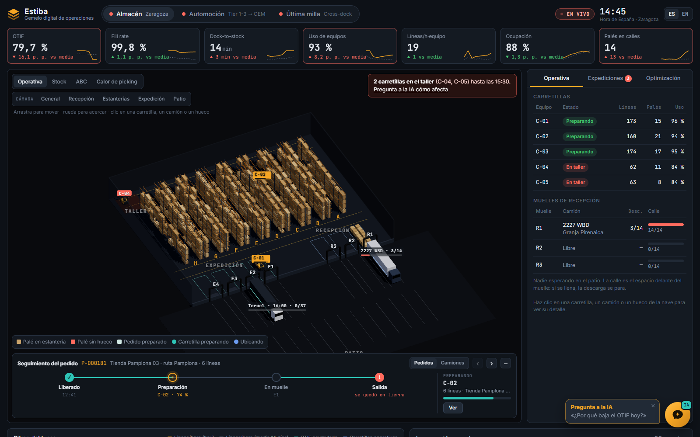
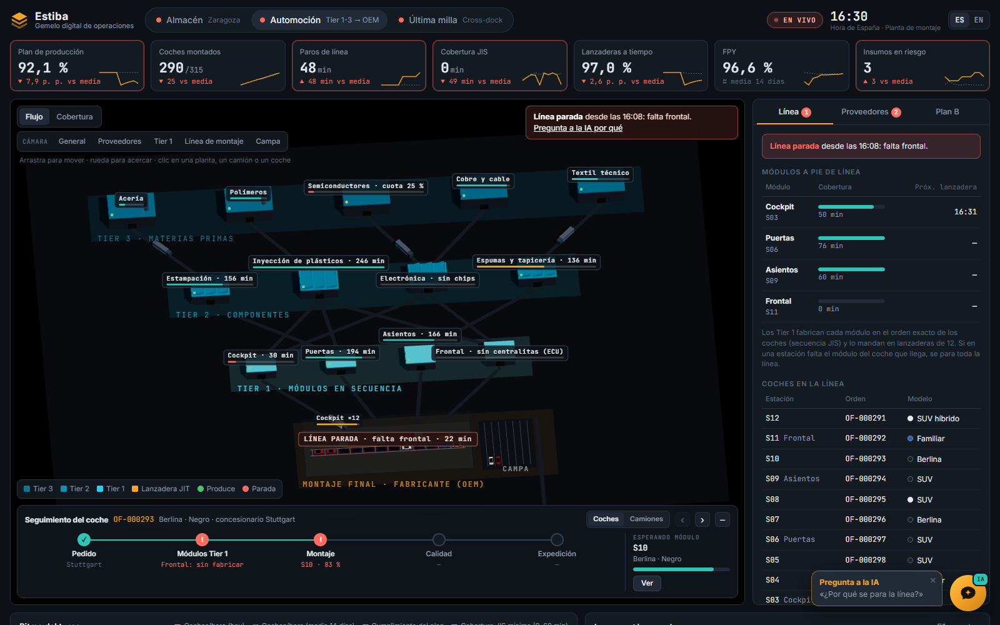
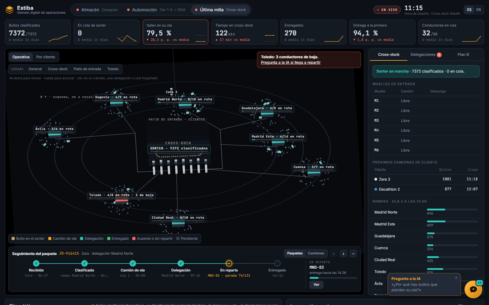
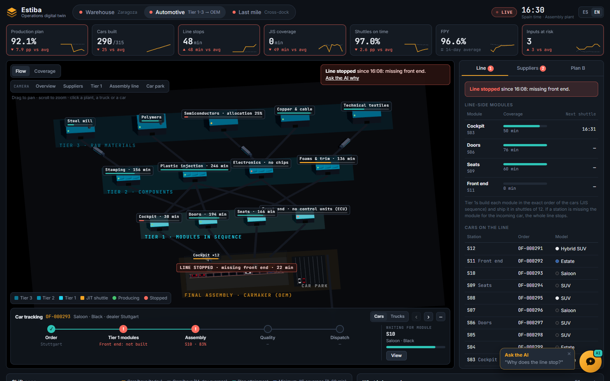
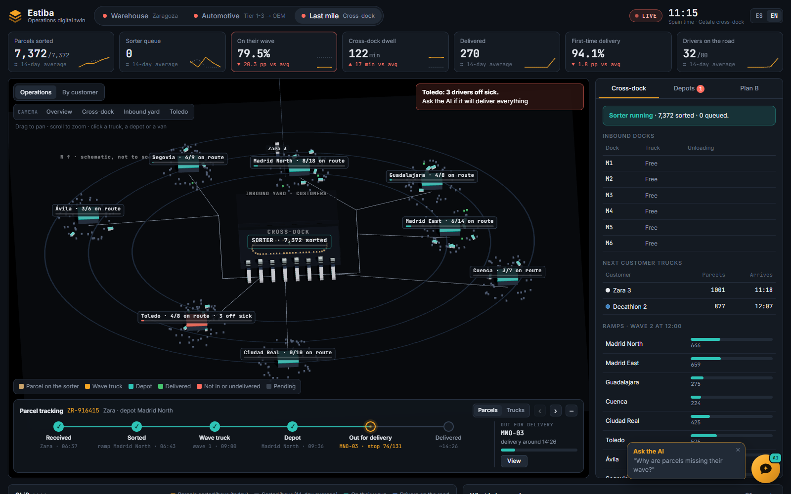

# Estiba · gemelo digital de operaciones logísticas

*Español · [English](#english)*

Tres operativas logísticas simuladas en 3D (un almacén, una cadena de suministro de automoción y una red de última
milla), cada una con su motor de simulación, sus indicadores, su seguimiento paso a paso y un asistente que explica
las desviaciones con los datos del propio turno.

**Demo en vivo: https://d1ex3zlctjya5a.cloudfront.net**

La operativa se elige arriba (o con `?op=almacen`, `?op=automocion` o `?op=milla` en la URL). La interfaz y el
asistente funcionan en español e inglés (botón ES/EN, o `?lang=es` / `?lang=en`).

<p>
  <a href="https://d1ex3zlctjya5a.cloudfront.net/?op=almacen&amp;lang=es"></a>
  <a href="https://d1ex3zlctjya5a.cloudfront.net/?op=automocion&amp;lang=es"></a>
  <a href="https://d1ex3zlctjya5a.cloudfront.net/?op=milla&amp;lang=es"></a>
</p>

No es una maqueta: cada carretilla, camión, coche y furgoneta que se ve sale de un motor de simulación determinista
que avanza en pasos de 15 segundos (la misma semilla da siempre el mismo día), y los indicadores se calculan sobre lo
que ocurre en él. En la última milla los bultos se simulan en lotes de hasta 25, y 40 de ellos se siguen de punta a
punta.

## Las tres operativas

Cada una esconde un problema hoy para que el análisis tenga algo que encontrar. Las capturas son del turno en vivo,
a la hora en que se ve.

### Almacén (Zaragoza)

[](https://d1ex3zlctjya5a.cloudfront.net/?op=almacen&lang=es)

- **La nave:** 8 pasillos de estanterías a dos caras (640 huecos en 4 niveles) con 380 referencias. Recibe unos 11
  camiones de proveedor por 3 muelles y prepara unos 300 pedidos al día para 9 rutas (de 08:30 a 20:30), que salen
  por 4 muelles de expedición. Cinco carretillas ubican los palés y preparan los pedidos.
- **Cadena completa:** camión → patio → muelle → calle de recepción → la carretilla ubica el palé → stock disponible
  → liberación por olas → picking → la ruta sale a su hora. Un fallo se propaga en los dos sentidos: las mismas
  carretillas preparan y ubican, lo urgente (rutas que salen en menos de 80 min) va antes que ubicar, y si la calle
  de un muelle se llena (14 palés), el camión deja de descargar.
- **Indicadores:** OTIF, fill rate de líneas, dock-to-stock, uso de equipos, líneas por hora y equipo, ocupación y
  palés en calles.
- **Expediciones:** las nueve rutas con sus pedidos listos y su estado (a tiempo, justa o en riesgo; al salir,
  completa o incompleta). Una ruta está en riesgo cuando su trabajo pendiente, sumado al de las que salen antes, no
  cabe en los minutos de carretilla que quedan hasta su salida.
- **Vistas de la nave:** operativa, nivel de stock por hueco, clasificación ABC y calor de picking.
- **Optimización:** tres escenarios calculados sobre los pedidos del día, en minutos y metros por pedido: «como está
  hoy» (recorrido en el orden del albarán), «con ruta optimizada» (vecino más próximo) y «slotting ABC + ruta» (lo
  que más se mueve, en los huecos más cercanos a expedición y más bajos), con los cambios de ubicación de más impacto.
  Además, el día completo se re-simula con el slotting ABC (mismos pedidos, camiones e incidencias) para compararlo
  con el actual.
- **Hoy:** dos de las cinco carretillas (C-04 y C-05) pasan por el taller entre las 09:45 y las 15:30. Con tres, lo
  urgente pasa por delante de ubicar y la calle de R1 se llena hacia las 14:00. El retraso dura más que el taller: al
  volver, las cinco siguen ocupadas con el picking atrasado, las calles de R2 y R3 se llenan por la tarde y hay
  camiones parados en el muelle hasta las 20:00. Las rutas de Logroño (13:00) a Soria (19:00) salen con pedidos en
  tierra y el OTIF del día acaba en el 70 %, frente al 94 % de media de los 14 días anteriores.

### Automoción (proveedores Tier 1-3 → fabricante)

[](https://d1ex3zlctjya5a.cloudfront.net/?op=automocion&lang=es)

- **La pirámide en una escena:** cinco Tier 3 (materias primas), cuatro Tier 2 (componentes) y cuatro Tier 1 que
  fabrican módulos **en secuencia** (cockpit, puertas, asientos y frontal) y los mandan en lanzaderas JIT a una línea
  de montaje síncrona de 12 estaciones (un coche cada 2 min); al final, banco de pruebas, retrabajo, campa y
  portavehículos.
- **Aprovisionamiento por tirón:** cada cliente pide a su proveedor cuando su stock más lo que viene de camino baja del
  punto de pedido. Si a una estación le falta el módulo del coche que entra, se para toda la línea.
- **Vistas:** flujo (cada planta con su estado: produce, cuota recortada o parada) y cobertura (cada planta coloreada
  por lo que le dura su insumo más justo). Pestañas de línea (módulos a pie de línea y coche de cada estación),
  proveedores y plan B.
- **Indicadores:** cumplimiento del plan, coches montados, minutos de paro, cobertura JIS a pie de línea, lanzaderas a
  tiempo, FPY e insumos en riesgo.
- **Plan B:** re-simula el día desde las 06:00 con un proveedor alternativo de chips que entra a las 10:00. El plan
  pasa del 74 % al 98 % (471 de 480 coches).
- **Hoy:** el fabricante de semiconductores recorta la cuota de chips al 25 % desde las 06:00. Electrónica (Tier 2) se
  queda sin chips a las 07:40, pero la línea no lo nota hasta las 15:43: desde entonces para una y otra vez por falta
  de frontales (de 16:08 a 18:49 no se mueve) y, al final del turno, de cockpits sin centralitas. Además, un accidente
  retrasa 58 min la lanzadera de asientos y para la línea 17 min a las 11:06. El día acaba con 356 de 480 coches
  (74 %) y 246 min de paro; en los 14 días anteriores no hubo ninguno.

### Última milla (cross-dock de Getafe → ocho delegaciones → cliente final)

[](https://d1ex3zlctjya5a.cloudfront.net/?op=milla&lang=es)

- **Cross-dock:** unos 9.000 bultos al día en diez camiones de cinco clientes (moda, deporte, comida a domicilio
  refrigerada y e-commerce) → patio → seis muelles de entrada → cola de inducción (lo refrigerado, primero) → sorter →
  rampa de cada delegación → camiones en tres olas (09:00, 12:00 y 15:00).
- **Delegaciones de provincia** en un esquema por rumbo y distancia, con sus furgonetas repartiendo y los puntos de
  entrega que se marcan como entregados o ausentes.
- **Indicadores:** bultos clasificados, cola del sorter, bultos que salen en su ola, tiempo en el cross-dock,
  entregas, entrega a la primera y conductores en ruta.
- **Plan B:** re-simula el día desde las 06:00 con inducción manual durante el atasco (al 45 % del ritmo del sorter) y
  tres conductores de refuerzo en Toledo. Lo que queda sin repartir al cierre baja de 481 a 190 bultos.
- **Hoy:** el sorter se atasca de 08:05 a 09:05, justo antes de la primera ola; un camión de Zara llega 75 min tarde y
  Toledo tiene tres conductores de baja. Sale en su ola el 89 % de los bultos (1.012 pierden la suya) y 481 se quedan
  sin repartir, 335 de ellos en Toledo.

## Común a las tres

- **En vivo:** el reloj es la hora real de España y la simulación avanza minuto a minuto. El turno es de 06:00 a 22:00;
  de noche se reproduce el turno de día en diferido (con el aviso «EN DIFERIDO»).
- **Indicadores frente a la media de los 14 días anteriores** a la misma hora del día (mismo motor, otras semillas),
  cada uno con su minigráfica; en automoción y última milla, minuto a minuto.
- **Panel del turno:** gráfica «Ritmo del turno» por horas frente a la media, registro «Lo que está pasando» y, en el
  selector de arriba, un punto de estado por operativa.
- **Seguimiento paso a paso** al pie de la escena, con botón para ir a lo que se sigue:
  - Almacén: un pedido o un camión.
  - Automoción: un coche (pedido → módulos Tier 1 → montaje → calidad → expedición), o un camión o una lanzadera
    entre proveedores.
  - Última milla: un paquete (recibido → clasificado → camión de ola → delegación → reparto → entregado o ausente), o
    un camión de cliente o de ola.
- **Avisos emergentes** con «Ver» (vuela la cámara hasta lo que pasa) y «Pregunta a la IA».
- **Cámara:** encuadres por zona, seguimiento de lo que se mueve y etiquetas con barra de progreso.
- **Asistente** en burbuja flotante: responde a «¿por qué baja el OTIF?», «¿por qué se para la línea?» o «¿por qué hay
  bultos que pierden su ola?». La cadena de causas se recorre en el navegador, y Claude (Haiku 4.5 en Amazon Bedrock,
  `lambda/asistente`) redacta la respuesta a partir de ese diagnóstico. El servidor comprueba lo que redacta, no solo
  lo pide en el prompt: toda cifra u hora tiene que estar en los datos que recibe, la explicación no puede recomendar
  nada y las acciones salen, por id, de una lista cerrada. Si la redacción no pasa esos controles, se le pide una vez
  que la rehaga; si vuelve a fallar, se muestra la respuesta calculada en el navegador, que es también la que se da
  sin Lambda, si la llamada falla o si se agota el tope diario.
- **Preguntas sobre el autor o sobre Estiba** (quién lo ha hecho, qué es, si los datos son reales, con qué está
  hecho): las contesta con la ficha profesional del autor, con datos verificados y su LinkedIn.
  `lambda/asistente/ruta.mjs`, el mismo módulo en el navegador y en la Lambda, decide a qué parte va cada pregunta; lo
  dudoso lo resuelve una llamada corta al modelo.

## Cómo está hecho

| Pieza | Fichero |
| --- | --- |
| Escena compartida (renderizador, cámara, encuadres, anillo de selección) | `src/scene/stage.js` |
| Operativas (lo propio de cada una: indicadores, pestañas, avisos, seguimiento) | `src/ops/*.js` |
| Almacén: la nave y la incidencia de hoy, geometría, motor, slotting, diagnóstico, escena | `src/data/sites.js`, `src/sim/layout.js`, `src/sim/engine.js`, `src/analysis/optimize.js`, `src/analysis/assistant.js`, `src/scene/warehouse3d.js` |
| Automoción: red de proveedores, motor, diagnóstico, escena | `src/data/automocion.js`, `src/sim/automocion.js`, `src/analysis/asistenteAuto.js`, `src/scene/automocion3d.js` |
| Última milla: clientes y delegaciones, motor, diagnóstico, escena | `src/data/ultimamilla.js`, `src/sim/ultimamilla.js`, `src/analysis/asistenteMilla.js`, `src/scene/ultimamilla3d.js` |
| Aleatoriedad con semilla: la misma semilla da el mismo día | `src/sim/rng.js` |
| Histórico de 14 días y media de referencia (por hora y, en automoción y última milla, minuto a minuto) | `src/analysis/history.js` |
| Llamada a la Lambda del asistente | `src/analysis/remote.js` |
| Lambda: manejador, comprobación de cifras, filtro de recomendaciones, ruta de preguntas y respuestas sobre el autor | `lambda/asistente/index.mjs`, `cifras.mjs`, `acciones.mjs`, `ruta.mjs`, `ali.mjs` |
| Interfaz e idiomas | `index.html`, `src/main.js`, `src/ui/*`, `src/i18n.js`, `src/style.css` |
| Pruebas y calibración | `test/*.test.mjs`, `scripts/probar-*.mjs` |

Sin frameworks: Vite + Three.js + JavaScript. En producción: S3 + CloudFront (con OAC) para la web y una Lambda
con Function URL para el asistente (`deploy.ps1`).

## Uso

```bash
npm install
npm run dev        # http://localhost:5190
npm test           # los tres motores, el slotting, los asistentes y los controles de la Lambda
npm run build      # genera dist/
node scripts/probar-dia.mjs 5     # almacén: indicadores de 5 días, para calibrar
node scripts/probar-auto.mjs 5    # automoción (añade «dual» para el plan B)
node scripts/probar-milla.mjs 5   # última milla (añade «refuerzo» para el plan B)
```

Esc quita la selección.

`test/ali.test.mjs` necesita `lambda/asistente/ficha-ali.mjs`, la ficha del autor, que no está en el repositorio
(ver el apartado siguiente): en un clon limpio ese fichero de pruebas falla y el resto pasa. La web no la necesita.

## Asistente con Bedrock (opcional)

1. Crear una Lambda (Node.js 22) con los `.mjs` de `lambda/asistente` (`index.mjs` es el manejador) y una Function
   URL con CORS limitado al dominio de la web. `ali.mjs` importa `ficha-ali.mjs`, la ficha del autor que comparten
   sus otros chats; se copia desde fuera del repositorio y sin ella la Lambda no carga, así que para montar una propia
   hay que poner ahí una ficha que exporte lo mismo.
2. Dar permiso `bedrock:InvokeModel` sobre el perfil de inferencia `us.anthropic.claude-haiku-4-5-20251001-v1:0` y
   sobre el modelo base `anthropic.claude-haiku-4-5-20251001-v1:0` en las regiones a las que enruta.
3. Variables opcionales: `BEDROCK_REGION` (por defecto `us-east-1`), `MODELO` (por defecto ese perfil),
   `TOPE_DIARIO` (preguntas del turno al día por contenedor, 300) y `TOPE_ALI` (preguntas sobre el autor, 40). Al
   agotarse un tope, la Lambda responde 429 y la web contesta con el motor local.
4. Compilar la web con la URL: `VITE_ESTIBA_API=https://…lambda-url…/ npm run build`. Sin esa variable, el asistente
   responde solo con el motor local.

En la cuenta del autor, `deploy.ps1 -Lambda` hace el resto: pasa `npm test`, sube los seis `.mjs` a la función
`estiba-asistente` (que ya tiene que existir), compila con la URL y publica la web. La región, el bucket, la
distribución de CloudFront y la URL están fijados en el script.

## Aviso

Todos los datos son simulados: pedidos, proveedores, volúmenes e incidencias son ficticios. Las marcas de la última
milla (Zara, Inditex, Decathlon, Gousto) se citan solo como ejemplo del tipo de cliente; no hay relación con ellas.

Autor: [Ali Aauicha](https://www.linkedin.com/in/ali-aauicha/)

---

## English

**Estiba** is a 3D digital twin of three logistics operations (a warehouse, an automotive supply chain and a
last-mile network). Each one has its own simulation engine, KPIs, step-by-step tracking and an assistant that
explains deviations using the shift's own data.

**Live demo: https://d1ex3zlctjya5a.cloudfront.net/?lang=en**

Pick the operation at the top, or link straight to one with `?op=almacen` (warehouse), `?op=automocion` (automotive)
or `?op=milla` (last mile). The UI and the assistant work in English and Spanish (ES/EN toggle, or `?lang=en` /
`?lang=es`).

<p>
  <a href="https://d1ex3zlctjya5a.cloudfront.net/?op=almacen&amp;lang=en"></a>
  <a href="https://d1ex3zlctjya5a.cloudfront.net/?op=automocion&amp;lang=en"></a>
  <a href="https://d1ex3zlctjya5a.cloudfront.net/?op=milla&amp;lang=en"></a>
</p>

It is not a mock-up: every forklift, truck, car and van on screen comes from a deterministic simulation that advances
in 15-second steps (the same seed always plays out the same day), and the KPIs are computed from what happens in it.
In the last mile, parcels move in batches of up to 25, and 40 of them are tracked end to end.

- **Warehouse (Zaragoza):** 640 rack locations, 380 SKUs, about 300 orders a day for 9 routes, five forklifts that
  both put away and pick. Yard → dock → receiving lane → put-away → stock → wave release → picking → route departure.
  KPIs: OTIF, line fill rate, dock-to-stock, equipment utilisation, lines per equipment-hour, occupancy and pallets in
  lanes; a dispatch tab with routes on time, tight or at risk; ABC slotting compared on the day's orders and in a full
  re-simulation. Today two of the five forklifts go to the workshop between 09:45 and 15:30. Urgent picking comes
  before put-away, the receiving lanes fill up and the backlog outlasts the workshop: the routes from 13:00 to 19:00
  leave orders behind and the day's OTIF ends at 70%, against a 94% average.
- **Automotive supply chain:** Tier 3 raw materials → Tier 2 components → Tier 1 modules built **in sequence** and
  sent in JIT shuttles to a 12-station synchronous assembly line (one car every 2 minutes) → test bench, rework, car
  park and transporters, all in one scene, with pull replenishment. KPIs: plan attainment, cars built, line stops, JIS
  coverage, shuttles on time, FPY, inputs at risk. Today the chip maker cuts the allocation to 25% from 06:00: it takes
  hours to show, but from 15:43 the line keeps stopping for lack of front ends and, late in the shift, cockpits
  without control units; a motorway accident also holds up the seat shuttle by 58 min and stops the line at 11:06.
  The day ends at 74% of plan. Plan B re-simulates the day with an alternative chip supplier from 10:00 (98%).
- **Last mile (Getafe cross-dock):** about 9,000 parcels a day from five customers (fashion, sport, chilled meal kits,
  which go first, and e-commerce) → six inbound docks → sorter → depot ramps → three departure waves (09:00, 12:00, 15:00) → eight
  provincial depots → vans → end customer. KPIs: parcels sorted, sorter queue, parcels on their wave, cross-dock
  dwell, deliveries, first-time delivery and drivers on the road. Today the sorter jams from 08:05 to 09:05, a Zara
  truck arrives 75 min late and Toledo has three drivers off sick: 89% of parcels leave on their wave and 481 are
  left undelivered. Plan B (manual induction during the jam and three standby drivers) brings that down to 190.
- **Shared:** live Spain time (replay at night); every KPI against the previous 14 days at the same time of day (per
  minute in automotive and last mile); a shift-pace chart and an event feed; step-by-step tracking of an order, car,
  parcel or truck with a button to fly to it; pop-up alerts with "View" and "Ask the AI"; camera presets, follow mode
  and labels with progress bars.
- **AI assistant:** the browser walks the chain of causes from the shift data, and Claude (Haiku 4.5 on Amazon
  Bedrock, `lambda/asistente`) writes the answer from that diagnosis. The server checks what it writes: every figure
  must be in the data, the explanation cannot recommend anything, and actions are picked by id from a closed list.
  If an answer fails those checks after one retry, or the Lambda is unavailable, the browser's own answer is shown.
  Questions about the author or about Estiba itself are answered from the author's professional profile, with
  verified facts and a link to the author's LinkedIn.

Built with Vite + Three.js + plain JavaScript, no frameworks. `src/main.js` is one generic page; each operation is an
adapter in `src/ops/*.js` on top of a shared scene (`src/scene/stage.js`); the engines are in `src/sim/` and the
diagnoses in `src/analysis/`. Deployed on S3 + CloudFront (OAC) for the site and a Lambda Function URL for the
assistant (`deploy.ps1`).

Run it locally with `npm install` and `npm run dev` (http://localhost:5190); `npm test` runs the tests and `npm run
build` writes `dist/`. `test/ali.test.mjs` needs the author's profile (`lambda/asistente/ficha-ali.mjs`), which is
not in the repository, so in a fresh clone that test file fails and the rest pass. The assistant uses Claude only when
the site is built with `VITE_ESTIBA_API` pointing at the Lambda; otherwise it answers from the local engine. See the
Spanish section for the Lambda setup.

All data is simulated; last-mile brands are named only as example customers, with no relationship to them.

Author: [Ali Aauicha](https://www.linkedin.com/in/ali-aauicha/)
